# Azure Storage – Sikker lagring, tilgangskontroll og overvåking

**Praktisk Azure-prosjekt | AZ-104 – Azure Administrator**

## 1. Prosjektoversikt

I dette prosjektet har jeg opprettet, konfigurert, sikret og overvåket en Azure Storage-løsning gjennom Azure Portal. Øvelsen gir praktisk erfaring med Azure Blob Storage, Microsoft Entra ID, Azure RBAC, nettverkssikkerhet, Azure Monitor og kostnadskontroll.

**Prosjektmål:**
- Opprette og organisere Azure-ressurser.
- Konfigurere en privat Blob-container og laste opp en testfil.
- Administrere tilgang med Microsoft Entra ID og Azure RBAC.
- Begrense nettverkstilgang og blokkere anonym Blob-tilgang.
- Kontrollere tilgang gjennom praktisk testing.
- Overvåke transaksjoner og konfigurere e-postvarsler.
- Følge med på kostnader i Azure Cost Management.

## 2. Teknologier

| Tjeneste | Formål |
|---|---|
| Azure Resource Group | Organisering av ressurser |
| Azure Storage Account | Lagringskonto |
| Azure Blob Storage | Privat fillagring |
| Microsoft Entra ID | Identitetsbasert autentisering |
| Azure RBAC | Rollebasert autorisasjon |
| Azure Monitor | Målinger og varsler |
| Azure Cost Management | Kostnadskontroll |
| Azure Portal | Administrasjon og testing |

## 3. Ressurser og lagring

Jeg opprettet ressursgruppen `AzureLab` og lagringskontoen `azstorageanday2026`.

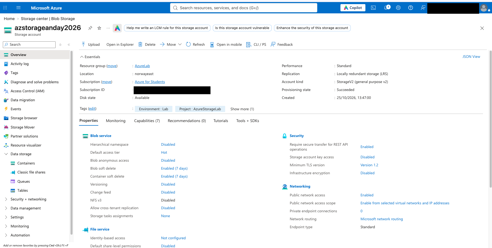

Jeg opprettet den private Blob-containeren `private-documents` og lastet opp testfilen `test.txt`.

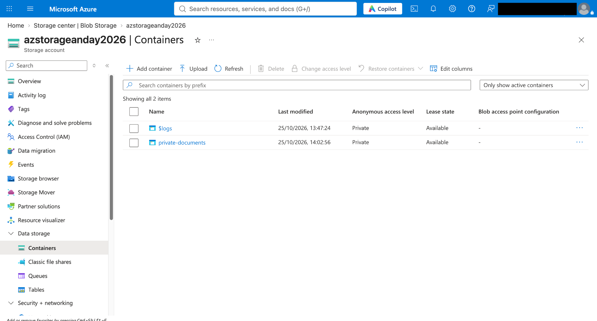

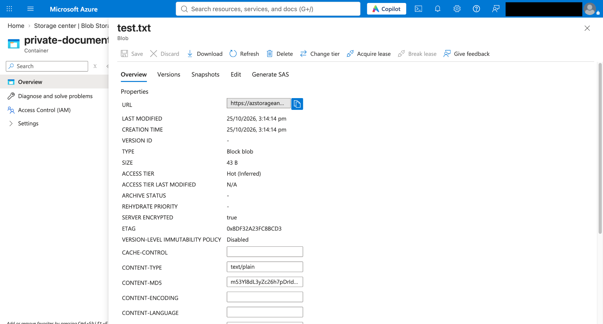

Ressursgruppen inneholdt også varslingsregelen `alert-storage-transactions` og handlingsgruppen `ag-storage-alerts`.

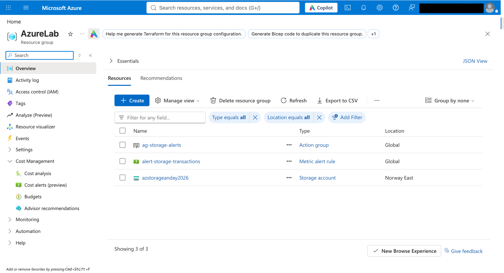

## 4. Sikkerhet og tilgangskontroll

### Nettverksbegrensning

Jeg konfigurerte offentlig nettverkstilgang fra **valgte nettverk og IP-adresser**. Dette er en nettverksbegrensning, men betyr ikke at offentlig nettverkstilgang er fullstendig deaktivert.

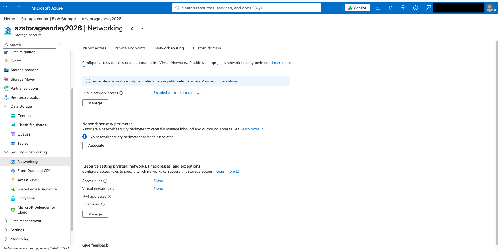

### Azure RBAC

Jeg tildelte rollen **Storage Blob Data Contributor** på containernivå. Jeg deaktiverte også tilgang med Storage Account Keys og benyttet Microsoft Entra ID for tilgang til Blob-data i øvelsen.

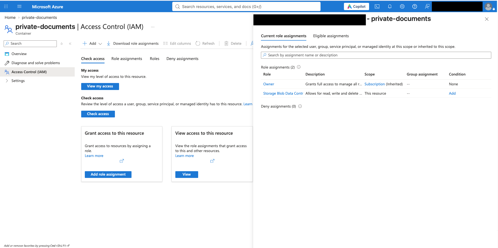

### Test av anonym tilgang

Jeg åpnet Blob-adressen i en nettleser uten autentisering. Azure returnerte feilen `PublicAccessNotPermitted`. Det bekrefter at anonym offentlig tilgang var blokkert i denne testen, men tester ikke alle mulige nettverks- eller RBAC-scenarioer.

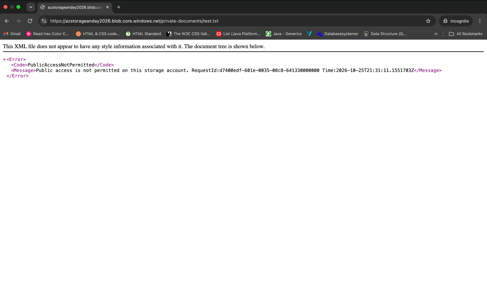

## 5. Overvåking og varsler

Jeg undersøkte **Transactions**-metrikken i Azure Monitor for å se aktivitet på lagringskontoen.

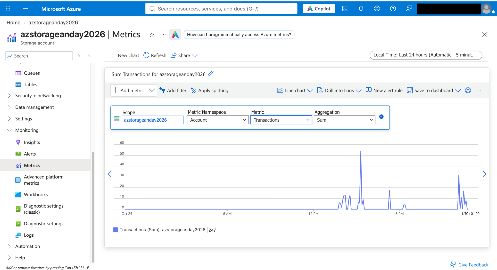

Deretter konfigurerte jeg en varslingsregel:

| Innstilling | Verdi |
|---|---|
| Alert Rule | `alert-storage-transactions` |
| Metric | Transactions |
| Terskel | Over 10 |
| Severity | 3 |
| Action Group | `ag-storage-alerts` |
| Varslingskanal | E-post |

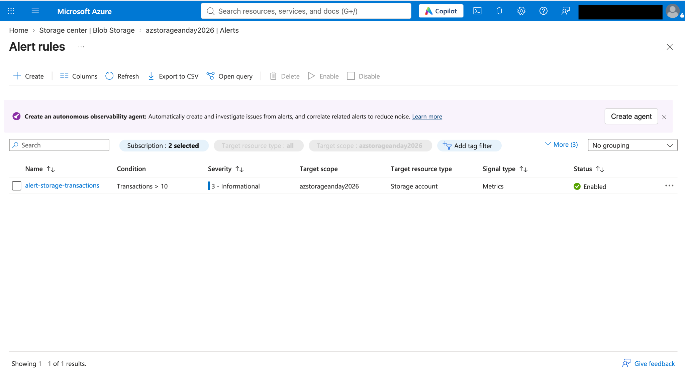

### Varsel utløst – Fired

Jeg mottok en e-post med tilstanden **Fired** og rapportert metrikkverdi **36**.

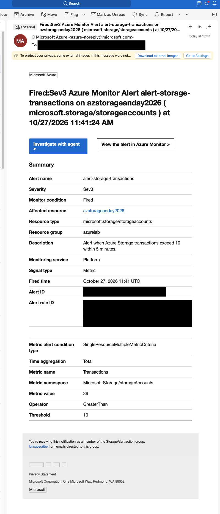

### Varsel avsluttet – Resolved

Jeg mottok senere en e-post med tilstanden **Resolved** og rapportert metrikkverdi **4**.

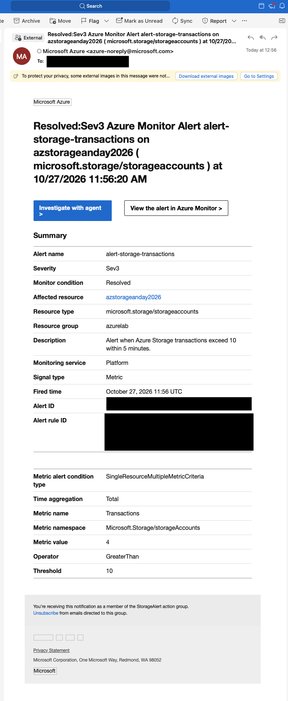

Dette dokumenterer at varslingsregelen og e-postvarslingen fungerte under øvelsen.

## 6. Kostnadskontroll

Prosjektet ble gjennomført med Azure for Students. Jeg kontrollerte kostnadsoversikten i Azure Cost Management. På tidspunktet for skjermbildet var registrert kostnad under **0,01 NOK**; dette er ikke nødvendigvis sluttkostnaden.

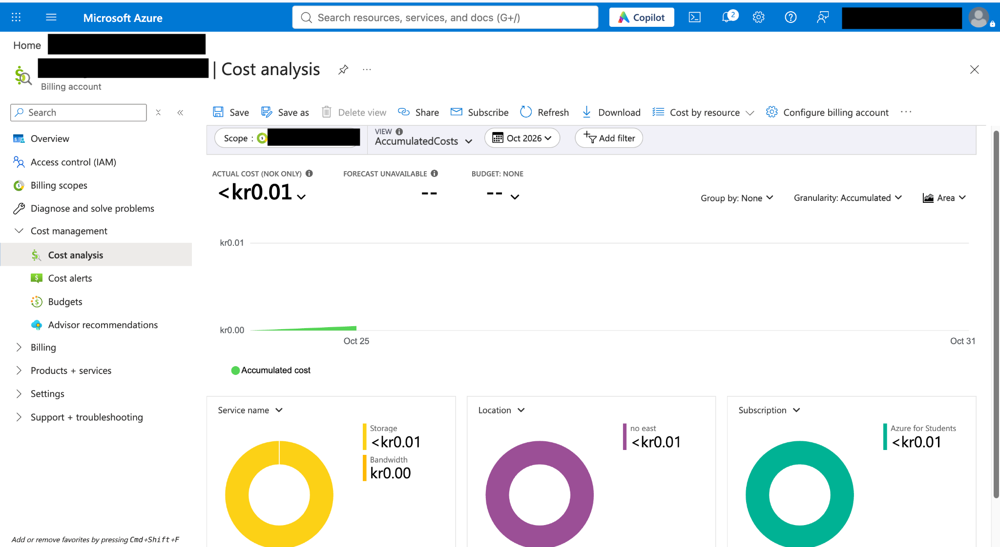

## 7. Læringsutbytte

Prosjektet ga meg praktisk erfaring med ressursadministrasjon, privat Blob Storage, identitetsbasert tilgang, RBAC, nettverksbegrensninger, tilgangstesting, overvåking, automatiske varsler og kostnadskontroll.

## 8. Videre arbeid

Dette er første prosjekt i [Azure Administration Labs](../README.md). Porteføljen utvides etter hvert med nye AZ-104-øvelser innen blant annet virtuelle maskiner, nettverk, identitet, backup og automatisering.

---

*Prosjektet er en laboratorieøvelse og ikke en produksjonsløsning.*
