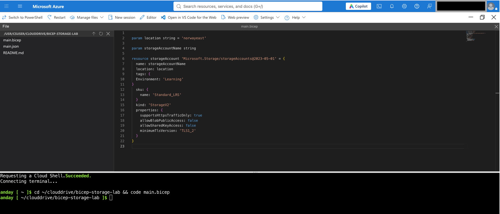
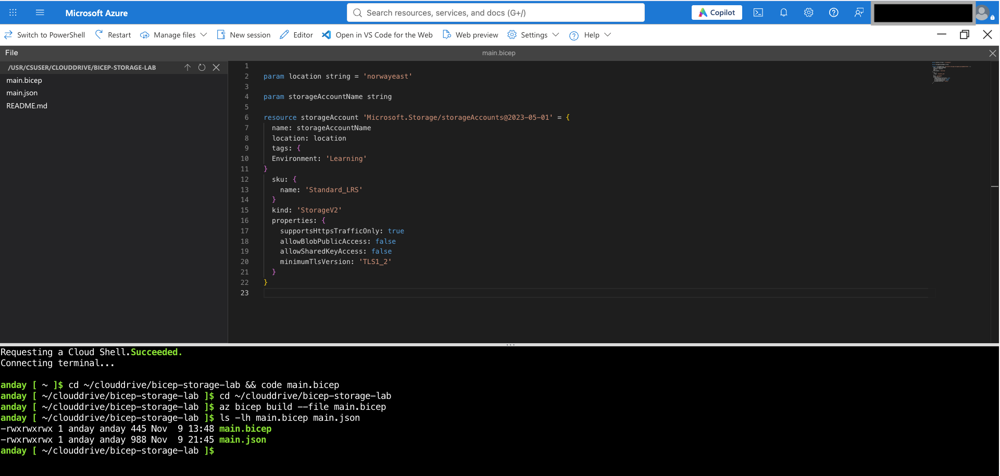
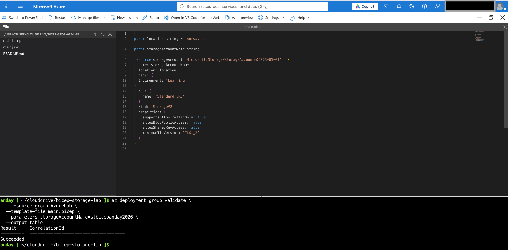
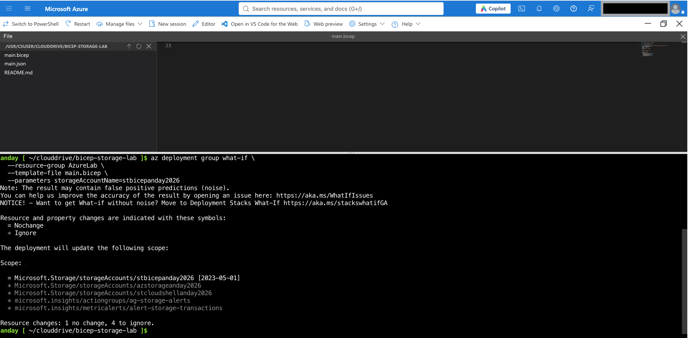
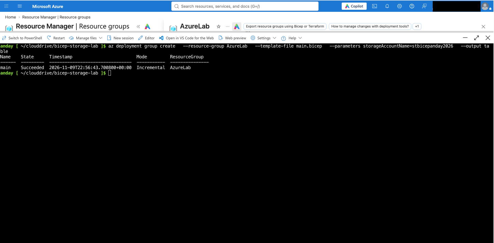
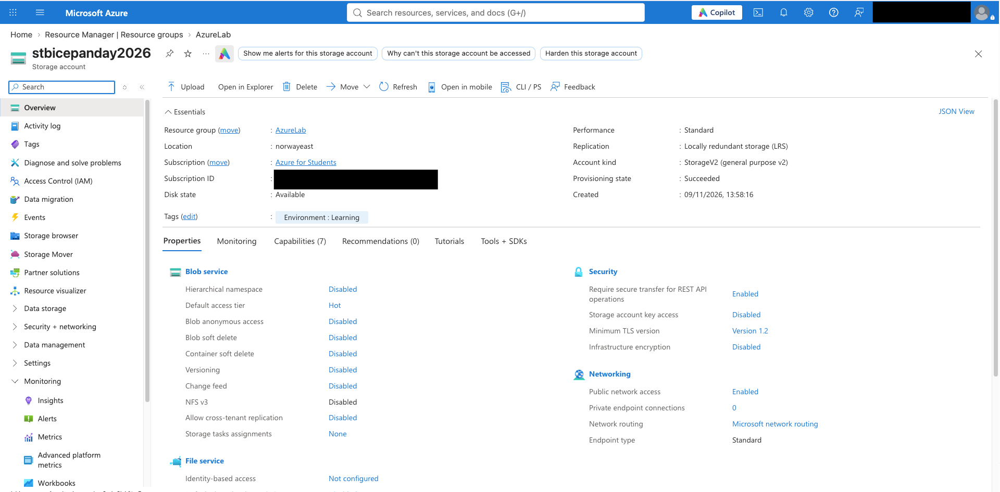
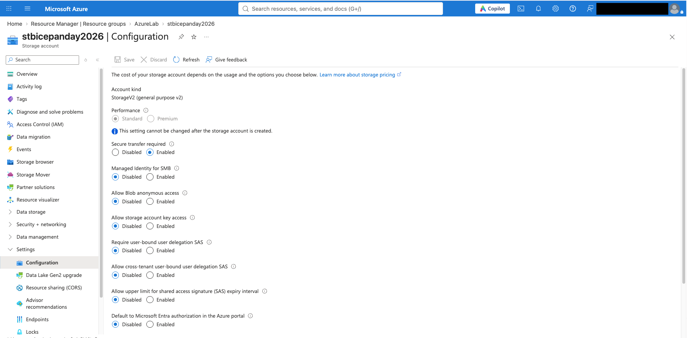

## Skjermbilder

### 1. Bicep-kode
Bicep-malen definerer Storage Account, parametere, ressursmerking og sikkerhetsinnstillinger.

### 2. Bicep Build
Bicep-filen kompileres til en ARM-mal (`main.json`) med Azure CLI.

### 3. Validering
Azure validerer malen før utrulling. Resultatet viser `Succeeded`.

### 4. What-If
What-If sammenligner Bicep-koden med eksisterende Azure-ressurser uten å endre dem. Resultatet viser `1 no change, 4 to ignore`.

### 5. Utrulling
Utrullingen ble gjennomført med Azure CLI. Resultatet viser `Succeeded`.

### 6. Storage Account Overview
Lagringskontoen er opprettet i Norway East med Standard_LRS, StorageV2 og taggen `Environment: Learning`.

### 7. Sikkerhetsinnstillinger
HTTPS er påkrevd, anonym Blob-tilgang og Shared Key-tilgang er deaktivert, og minimum TLS-versjon er 1.2.

